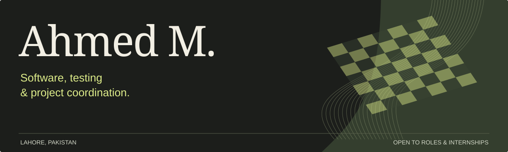

**Software Engineer · Software QA · Client & Project Coordination**

I build and test web applications, with a background in client communication and project coordination. Based in Lahore, Pakistan. Open to jobs and internships where I can contribute to software development, testing or project delivery.

  

## About me

I like understanding a problem before writing its solution: ask the useful questions, document the requirements, build something practical, and test it. My client-facing background helps me explain technical work clearly and keep the next step organised.

## Tech stack

| Area | Tools and skills |
| --- | --- |
| **Languages & web** | TypeScript · JavaScript · React · Next.js · HTML · CSS |
| **Data & backend** | SQL · PostgreSQL · Supabase · Express |
| **Quality assurance** | Playwright · Vitest · Manual testing · API testing · Test case design · Defect reporting |
| **Project coordination** | Jira · ClickUp · HubSpot · Requirements analysis · Sprint tracking · Status reporting |

## Selected work

| Project | What it does | Explore |
| --- | --- | --- |
| **[FlowPlan](https://github.com/iahmedmalik/FlowPlan)** | Project planning with task dependencies, critical path scheduling and slack calculations. Requirements, scheduling logic and automated tests live alongside the code. | [Live app](https://flow-plan-five.vercel.app/) · [Product brief](https://github.com/iahmedmalik/FlowPlan/blob/main/docs/PRD.md) · [Test report](https://github.com/iahmedmalik/FlowPlan/blob/main/docs/test-report.md) |
| **[QueueCare](https://github.com/iahmedmalik/QueueCare)** | A real-time clinic queue with urgent-patient priority, separate reception/doctor/patient views, and database access controls. | [Live app](https://queuecare-zeta.vercel.app/) · [Business requirements](https://github.com/iahmedmalik/QueueCare/blob/main/docs/BRD.md) · [Test report](https://github.com/iahmedmalik/QueueCare/blob/main/docs/test-report.md) |
| **[CommitteeKeeper](https://github.com/iahmedmalik/CommitteeKeeper)** | A savings committee tracker for payments, receipts, turns and an audit history. Business rules and data integrity shape the implementation. | [Live app](https://committeekeeper.vercel.app/) · [Business rules](https://github.com/iahmedmalik/CommitteeKeeper/blob/main/docs/business-rules.md) · [Test report](https://github.com/iahmedmalik/CommitteeKeeper/blob/main/docs/test-report.md) |
| **[PulseMetrics](https://github.com/iahmedmalik/PulseMetrics)** | A local product-analytics prototype covering event tracking, funnels and A/B testing, with API, database and browser tests. | [Product brief](https://github.com/iahmedmalik/PulseMetrics/blob/main/docs/PRD.md) · [Test report](https://github.com/iahmedmalik/PulseMetrics/blob/main/docs/TEST-REPORT.md) |
| **[SauceDemo manual QA](https://github.com/iahmedmalik/saucedemo-qa-testing)** | Test case design, execution records and defect reports for a public demo shop. Four login cases are recorded as executed; the remaining scope is unexecuted. | [Test workbook](https://github.com/iahmedmalik/saucedemo-qa-testing/blob/main/test-cases/manual-test-cases.xlsx) · [Execution report](https://github.com/iahmedmalik/saucedemo-qa-testing/blob/main/test-results/test-execution-report.md) |

These are personal portfolio projects. Their repositories document scope, test evidence and remaining work. Watch all four project films on my [portfolio](https://ahmed-m-portfolio.vercel.app/#work).

## Experience that informs the work

My client-facing background includes HOF Global, ibex, and LiveAdmins / CallStorm. At iTechGemini, my Project Management internship involved Jira and ClickUp tracking, sprint records, meeting actions and project documentation. That experience taught me to listen carefully, keep records clear and make the next step easy to follow.

## Away from the screen

Football and sport are a big part of what I enjoy outside work.

If you’re hiring for software development, QA or project coordination, I’d be glad to talk. [Email me](mailto:ahmedmalikk494@gmail.com) or connect on [LinkedIn](https://www.linkedin.com/in/ahmedmalik494/).
